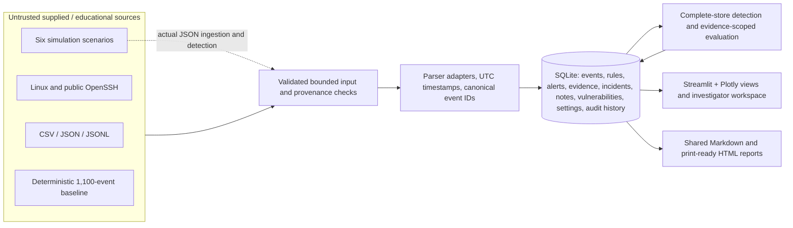
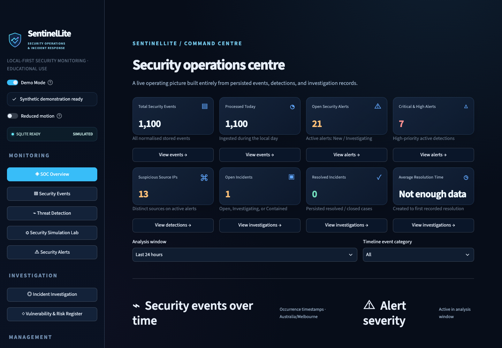
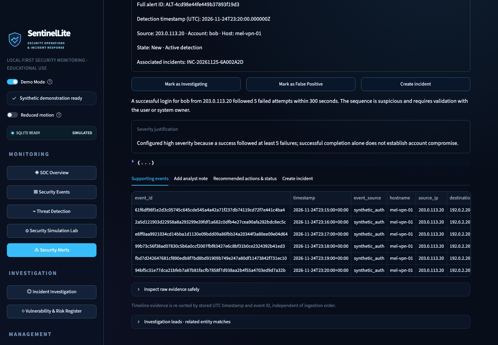
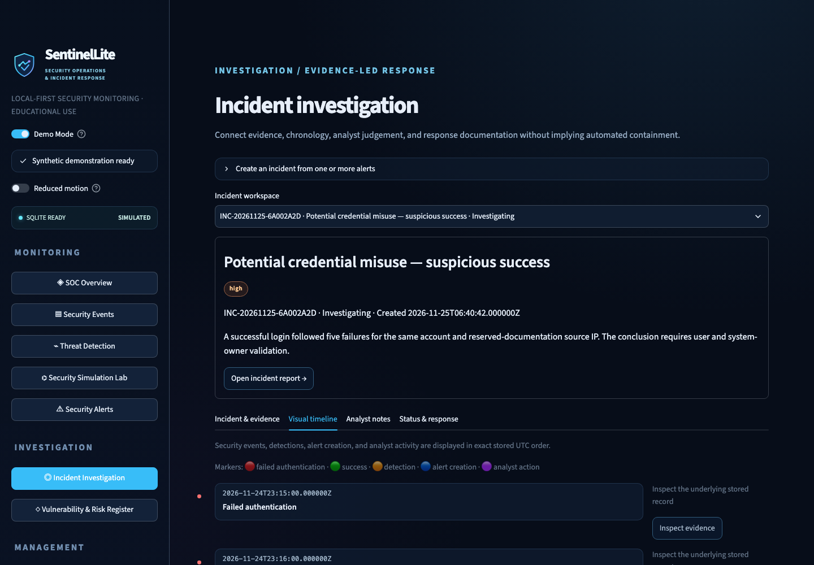
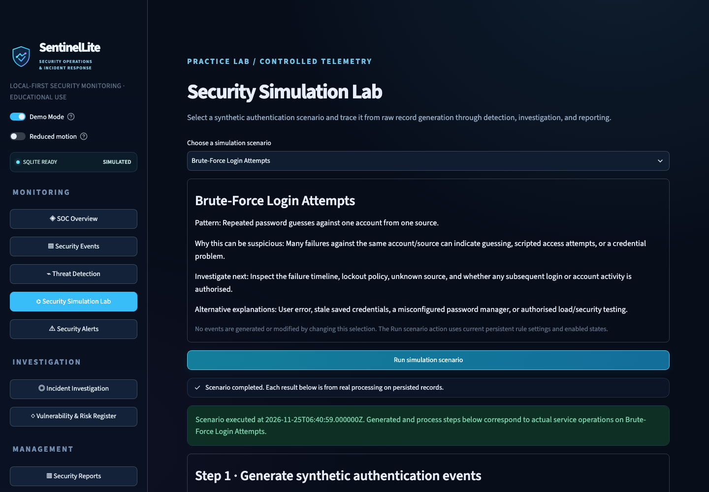
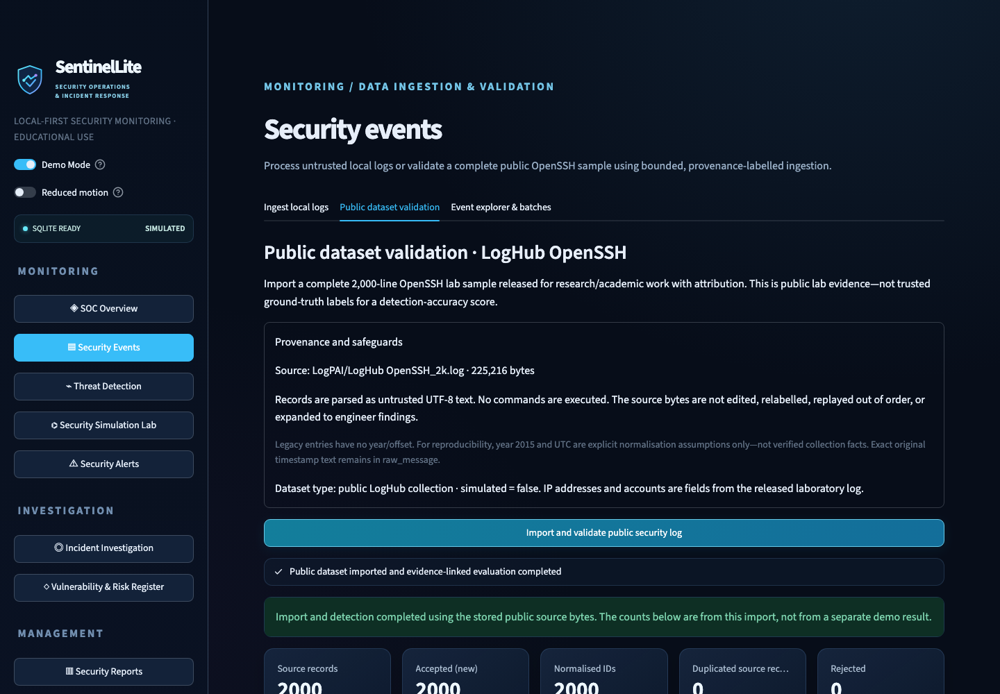
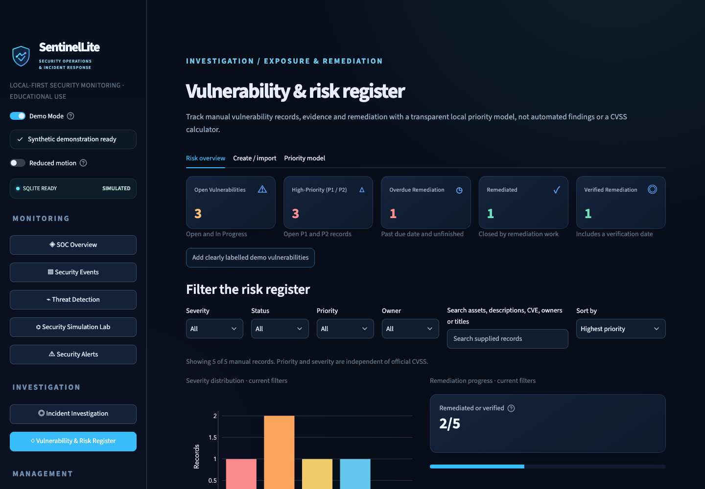
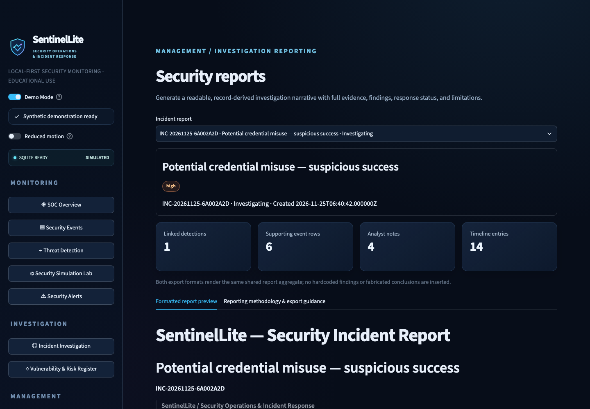
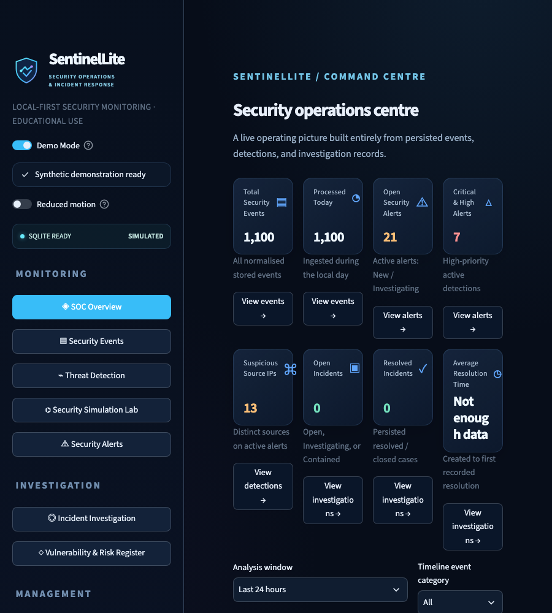
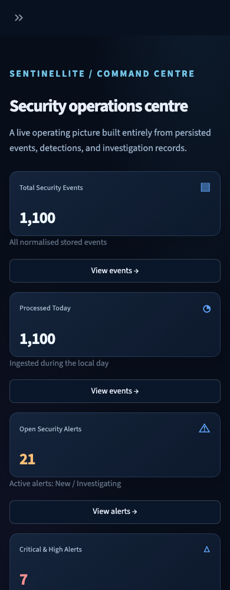

# SentinelLite

**Security monitoring, threat detection & incident investigation — without the fake dashboard.**

SentinelLite is a lightweight, local-first **educational SIEM-style security monitoring and investigation platform** built with Python, Streamlit, Plotly, Pandas, YAML, and SQLite. It ingests local security logs, normalises events, computes detections, persists evidence/alert relationships, and gives analysts a polished investigation workspace.

It demonstrates practical log analysis, detection engineering, investigation documentation, application security, accessibility, and maintainable full-stack development. It is **not an enterprise SIEM, EDR, vulnerability scanner, or automatic containment system**.

## Why SentinelLite?

SentinelLite makes the complete monitoring and investigation workflow inspectable:

```text
Source records
  → validated ingestion and normalisation
  → reproducible Python detections
  → persistently linked alert evidence
  → explicit analyst investigation
  → visual incident chronology
  → defensible Markdown and HTML reports
```

The upgraded Phase 2 experience adds a premium responsive design system, richer charts and alert navigation, visual incident timelines, an interactive six-scenario lab, and a verified public-data validation path. Visual effects never take priority over the correctness of those underlying records.

## Feature overview

| Navigation area | Actual capability |
|---|---|
| **SOC Overview** | Eight live KPI cards with navigation, severity/rule/incident distributions, adjustable event interval/category views, source-IP inspection, and a persisted security activity feed. No invented trends or percentages. |
| **Security Events** | Bounded CSV, JSON/NDJSON, Linux SSH, and LogHub OpenSSH ingestion; duplicate checks; field normalisation; raw source inspection; provenance and evidence-linked import reports. |
| **Threat Detection** | YAML-configured rules, configurable thresholds, horizontal active-alert coverage, status and latest-detection metadata, example evidence and scoped evaluation. |
| **Security Simulation Lab** | Six selectable patterns with a real six-step generate → ingest → detect → alert → investigate → document workflow, replay deduplication, disabled-rule behaviour, and scoped scenario evaluation. |
| **Security Alerts** | Searchable/filterable/sortable, paginated alert table with colour semantics and short display IDs; full-ID investigations, notes, quick statuses, evidence leads, and incident creation. |
| **Incident Investigation** | Explicit multi-alert correlation, visual and accessible timeline views, entity scope, per-node evidence inspection, editable persistent notes with edit auditing, status history, and response documentation. |
| **Vulnerability & Risk Register** | Five live summary metrics, severity/priority/status/owner filters, searches and sorting, progress visuals, manual creation/import, owners, evidence, due dates, and verification. |
| **Security Reports** | Nine-part record-derived narratives with branding, overview, detection evidence, timeline, findings, actions, status and uncertainty in both Markdown and print-ready HTML. |
| **Detection Rules** | Enablement, supported persistent configuration, documentation, metric-aware thresholds, and dry-run sample checks without manufacturing production results. |
| **Settings & Documentation** | Persistent author/timezone preferences, reduced-motion settings, audit and operating records, simulated-mode clarity, limitations, and operator guidance. |

All fields requiring untrusted manipulation continue through existing Python/SQL services, never as executable text supplied by a file or analyst.

## Navigation and accessibility

The sidebar is grouped into **Monitoring**, **Investigation**, and **Management**, with an original SentinelLite logo, navigation icons, active-page highlighting, a system indicator, and Demo Mode clarity. Existing deep links remain available, for example:

```text
?page=security-alerts&alert_id=<actual-alert-id>
?page=incident-investigation&incident_id=<actual-incident-id>
?page=security-reports&incident_id=<actual-incident-id>
?page=simulation-lab
```

Accessibility includes readable contrast, responsive layouts, keyboard focus states, accessible alternatives to visual timelines, tooltips, and a reduced-motion preference persisted in `application_settings`.

- An OS `prefers-reduced-motion: reduce` media query disables CSS transitions/animations.
- The sidebar **Reduced motion** preference also sets Plotly transition duration to zero and persists the setting.
- No continuous chart-refresh loop, JavaScript animation framework, or external font service is introduced.

The activity feed displays only recent **persisted activity** at a stated refresh point—it is not described as continuously live without a live ingest/update service.

## Architecture



### Preserved safety properties

- Parameterised SQL, transactional writes, foreign keys and indexed timestamp/entity fields.
- Fixed-width UTC timestamps preserve correct fractional-second range comparisons; existing stored dates are canonicalised at startup.
- Upload sizes, record formats/counts, raw field sizes and download bytes are bounded.
- Raw logs are treated as untrusted plain text and never executed.
- Raw evidence displays use plain text/dataframe/code components rather than unsafe HTML or untrusted Markdown.
- Reports escape HTML and Markdown links/images/table structure and imported line breaks.
- Synthetic/public sources remain explicitly distinguished by `simulated` and provenance metadata.
- Full-store detection recomputation preserves analyst notes/statuses/incident records. Repeated identical imports do not inflate events or force new alerts.
- No IP blocking, credential reset, host isolation, automatic firewall change, or invisible external scanning.

## Technology stack

| Technology | Role |
|---|---|
| Python 3 | Normalisation, detection, persistence, simulation, public log integration and reporting |
| Streamlit | Local interactive GUI, file handling, workflows, session state and application testing |
| Pandas | Filtering, aggregations and tabular charts |
| Plotly | Interactive event, rule, severity, status and remediation visualisations |
| SQLite (`sqlite3`) | Local persistent events, alerts, evidence pairs, incidents, notes, vulnerabilities, risk history and application settings |
| PyYAML | Human-readable Sigma-inspired custom rule definitions (no full Sigma compatibility claim) |
| Custom CSS/SVG | Original dark visual system, animated value emphasis, timeline markers, and original brand mark |
| Pytest + Streamlit AppTest | Backend, workflow, persistence and navigation/interaction regression coverage |
| Playwright (optional development-only) | Genuine screenshots, responsive checks and reduced-motion verification |

No Docker, VM, cloud account, paid API, heavy frontend framework, separate background service, or universal deployment claim is required.

## Install and run on macOS / Apple Silicon

Verified on ARM64 macOS with Python 3.14.9. Create an isolated environment and install runtime dependencies only:

```bash
git clone <your-repository-url> sentinellite
cd sentinellite
python3 -m venv .venv
source .venv/bin/activate
python -m pip install --upgrade pip
python -m pip install -r requirements.txt
```

When working in this delivered workspace instead of cloning, simply `cd /Users/kanishkakathait/Documents/cyberporject` before creating/activating the environment.

```bash
source .venv/bin/activate
streamlit run app.py
```

Open **http://localhost:8501**. Turn on **Demo Mode** for a clearly labelled 1,000-normal/100-suspicious baseline event set and real detected alerts, or open **Security Simulation Lab** to choose a specific scenario.

Stop with **Ctrl+C**, then optionally use `deactivate`. The default database is `data/sentinellite.db`. Override it without affecting that store:

```bash
SENTINELLITE_DB_PATH=data/generated/practice.db streamlit run app.py
```

No privileged port, Docker file, or continually running background script is needed. Runtime data is persisted locally unless the user deliberately manages it through an authorised application/database action.

## Three-minute demonstration


The short version:

1. **Select Suspicious Successful Login** in Security Simulation Lab.
2. **Run** the six generated records through the real ingestion and detection services.
3. Inspect the **five-failure-then-success evidence** and two different actual rules instead of a fabricated direct compromise verdict.
4. Open the chosen alert, review alternate explanations, save a note, and create an incident explicitly.
5. Inspect the colour-coded visual timeline and its per-node evidence details, then export the nine-part incident report.

Every displayed step is an actual completed operation, not an animation pretending work completed. Changing a scenario does not automatically ingest events. Replay handles duplicates honestly, and rules with no matching alert produce that outcome visibly.

## Visual incident investigation

The incident workspace retains the backend workflow:

```text
Open (new case) → Investigating → Contained → Resolved → Closed
```

Reopening is audited and clears the active resolution summary so a stale conclusion cannot remain in an active report. It does not erase the status history.

### Timeline and notes

- **Red:** failed authentication
- **Green:** successful authentication
- **Orange:** detection trigger
- **Blue:** alert creation
- **Purple:** analyst action

Each timeline node contains an exact UTC timestamp, type, title and evidence reference. Selecting **Inspect evidence** resolves the underlying event, alert, note, or status-history entry using its persisted identity. An accessible full timeline table remains available without removing evidence from the visualisation.

Analyst notes can be created and edited. Creation timestamps remain unchanged and edits are recorded in the audit log, with an edit timestamp available in the investigation and report. Notes and status updates document analyst work—they do not assert that SentinelLite contained a machine or reset a credential outside the app.

## Security Simulation Lab

Available patterns:

1. Brute-force login attempts
2. Password spraying / distinct-account authentication attempts
3. Suspicious successful login following bursts of failures
4. Privileged account activity
5. Authentication outside expected hours
6. Correlated suspicious authentication evidence

The existing scenario builders supply clearly labelled raw records. The lab serialises them as JSON, invokes the shared ingestion path and runs full-store detection. Actual resulting alerts are selected through their `alert_events` evidence relationships, then can be opened in the same investigation, incident and reporting UI as other records.

Expected rules are declared before execution. Scoped evaluation computes true positives, false positives, false negatives, precision, recall, and duplicate matches against those declared synthetic expectations, without counting unrelated shared-store alerts. A disabled rule or unmet threshold is explained rather than masking it with a fabricated test success.

## Public security dataset validation

The included **LogPAI / LogHub OpenSSH_2k.log** is a publicly published, laboratory-derived, research/academic dataset with required attribution and citation. It is not a claimed private production corpus.

- **2,000 complete original records** (225,216 bytes), no truncation or relabelling to manufacture detections.
- **SHA-256:** `1e4912727fa88245113d41b16a0cd25ceadba7f931e1c406542885b91254264f`.
- The original log, upstream `README.md`, licence text and a local manifest are preserved in `data/public/loghub_openssh/`.
- Required LogHub research citation, upstream blob references, licence and checksum/provenance details are documented in [THIRD_PARTY_NOTICES.md](THIRD_PARTY_NOTICES.md).
- Missing year/offset values use **2015 / UTC as normalisation conventions only**, not asserted source facts; raw timestamps remain available.
- Valid non-authentication SSH messages are retained as **system records** rather than fabricated auth failures, with missing IP/account fields left null.

Verified on a separate database using all 2,000 records:

- **2,000 accepted**, **0 rejected**;
- **519 authentication records**, **1,481 general system/SSH records**;
- **222 evidence-linked alerts**, comprising **77** repeated-failure, **110** off-hours, **18** privileged review, and **17** distinct-account detections;
- identical replay yields **0 accepted new events and 2,000 duplicates**, not inflated data;
- restart preserves event and alert evidence.

**No trusted scenario labels or precision/recall/false-positive rate is asserted for this public data.** Screens and reports expose the actual counts, rules, false-positive considerations, required validation and timestamp uncertainty. These are findings to investigate, not proven attacks.

See [all dataset information and limitations](docs/DATASETS.md). Synthetic scenario results similarly do not establish production detection accuracy.

## Reports

Incident reports share one database-backed aggregate for Markdown and HTML. Both contain a nine-part narrative: executive summary, incident overview, detection details, chronological timeline, supporting event evidence, analyst findings, recommended actions, incident status, and limitations/uncertainties.

- Every supporting log timestamp, raw message, status transition, note, affected account/host/IP and resulting rationale comes from the persisted record set.
- Synthetic/public/mixed-source origin labels prevent accidental confusion of educational and user-supplied evidence.
- Bespoke warning and severity sections distinguish detected activity, risk severity, interpretation and response documentation.
- **Dedicated PDF export is not implemented.** Use the branded HTML download and your browser's **Print → Save as PDF** workflow.

## Screenshots

These are genuine captures of the running application using labelled synthetic records and the bounded public dataset. They are not generated mock-ups.

### Premium command centre



### Interactive alert investigation



### Visual incident timeline



### Security Simulation Lab



### Public security-log validation



### Vulnerability and remediation overview



### Branded, record-derived report



### Responsive layouts

| Desktop 1440 px | Tablet 900 px | Mobile 390 px |
|---|---|---|
|  |  |  |

The responsive checks use actual Chromium browser sessions and assert presence of the completed app, absence of Streamlit exceptions, no unintended page-level horizontal overflow, and reduced-motion CSS on mobile.

## Verification

Run the automated suite from the project root:

```bash
source .venv/bin/activate
python -m pytest
python -m ruff check .
```

The final Phase 2 regression set reports **80 passing tests and a clean Ruff check**. It covers:

- all original ingestion/detection/persistence/entity/correlation/timezone/error-case contracts;
- every current navigation destination and core page controls;
- live activity retrieval, pagination and deterministic severity sorting;
- visual timeline markers, entity lookups, exact timestamps and note edit auditing;
- all six simulation scenarios, disabled rules, replays, restart persistence and unrelated-alert preservation;
- public LogHub provenance, real 2,000-line ingestion, checksum rejection, full result counts, replay deduplication and reports without constructed accuracy claims;
- vulnerability filtering, owner/status evidence and verification persistence;
- reduced-motion preference persistence and Plotly duration controls;
- real desktop/tablet/mobile responsive Chrome checks.

Optional development installation for screenshots and responsive checks:

```bash
source .venv/bin/activate
python -m pip install -r requirements-dev.txt
PLAYWRIGHT_BROWSERS_PATH=.playwright-browsers python -m playwright install chromium
PLAYWRIGHT_BROWSERS_PATH=.playwright-browsers python -m scripts.capture_screenshots
```

The development tooling is not required to run the application. Runtime installation uses `requirements.txt` alone.

### Baseline preservation

The Phase 2 work began with **48 passing tests plus a clean Ruff check**. A source-only pre-enhancement backup was created at `backups/sentinellite-pre-phase2.tar.gz` with SHA-256:

```text
b9c230fd179aebd22535ce3df508f7fc920638dc45a5cf60bc4016d2723a774d
```

The environment blocked creation of the initial `.git` metadata during autonomous work. Backup archives, virtual environments, Chromium binaries, local databases, generated data, caches and secrets are excluded from version control via `.gitignore` and are not pushed anywhere automatically.

Detailed verification is maintained in [docs/VERIFICATION.md](docs/VERIFICATION.md) and [docs/REVIEW_NOTES.md](docs/REVIEW_NOTES.md).

## Project structure

```text
├── app.py                       # Application shell and grouped navigation
├── assets/                      # Premium CSS and original brand SVG
├── core/                        # Database, schema, repositories, metrics and view models
├── detection/                   # Detection engine, evaluators, rules and episode semantics
├── ingestion/                   # Safe CSV/JSON/SSH and public-dataset adapters
├── investigations/              # Incidents, evidence timelines, vulnerability and risk services
├── simulation/                  # Deterministic baseline and true six-step interactive lab
├── reporting/                   # Shared incident/public-data report generation
├── pages/                       # All ten functional destination modules
├── data/sample/                 # Labelled synthetic baseline data and CSV templates
├── data/public/                 # Provenance-preserving public OpenSSH samples + licences
├── docs/                        # Guides, architecture, datasets, screenshots and verification
├── tests/                       # Automated backend, interaction and browser checks
├── scripts/                     # Isolated real-browser capture workflow
├── requirements.txt             # Runtime dependencies
├── requirements-dev.txt         # Optional browser and lint tooling
├── pyproject.toml               # Pytest and Ruff configuration
└── LICENSE                      # Project licence; third-party notices are separate
```

## Limitations and future extensions

**Limitations (not hidden future features):**

- Local, educational log-ingestion and investigation workflow; no enterprise authentication, RBAC, high availability, distributed queue, or tamper-proof audit service.
- Manual/bounded inputs rather than a real-time agent, remote endpoint monitor, external threat feed, or enterprise SIEM forwarding layer.
- No automatic IP blocking, host isolation, password reset, account lockout, firewall change, or other containment action.
- Custom detections only; no guarantee of full attack coverage, intelligence enrichment, production-scale throughput, or ground-truth accuracy.
- Full-store recompute favours reproducibility over unlimited live scale. Public-ground-truth claims are limited to declared synthetic mappings.
- Vulnerability records are manually entered/imported, not scanner output. The custom priority is not CVSS, organisational risk acceptance, exploitability, or confirmed impact.
- Responsive checks prove specified desktop/tablet/mobile Chromium viewports; they are not an exhaustive browser/device accessibility certification.
- Dedicated PDF export is not implemented; use the print-ready HTML instead.

**Possible future extensions (not claimed as implemented):**

- Production authentication/RBAC and staged schema migration framework
- Bounded live ingestion using an explicit, test-backed local queue
- A thoroughly tested Sigma-to-native rule conversion route
- Optional PDF renderer with deterministic local snapshot verification
- More diverse production-like telemetry, asset-criticity integrations and replayable research labels
- Validated external connector exports that preserve field schemas, evidence provenance, security review procedures and audit boundaries

## Licence and acknowledgements

The project source and original branding/design assets are released under the [MIT Licence](LICENSE).

Third-party LogHub research data remains under its own research/academic use and attribution terms. See [THIRD_PARTY_NOTICES.md](THIRD_PARTY_NOTICES.md), the included upstream `LICENSE_LOGHUB.txt`, and required publication citation. These materials do not transfer dataset ownership, imply partnership or endorsement by the data authors, or assert production deployment.
