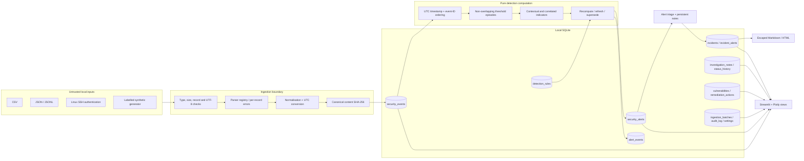

# Architecture

## Purpose and boundaries

SentinelLite demonstrates a complete security-operations workflow over manual local log evidence. It is deliberately lightweight and has no external collection or command-and-control plane.



## Runtime composition

`app.py` caches one `AppServices` wrapper per database path. The wrapper initialises the schema and YAML rule defaults, then exposes independent service/repository objects. SQLite connections are short-lived, use a 30-second timeout, enable foreign keys and WAL journaling, and commit through a context manager. Exceptions roll transactions back.

Detection results are computed in memory from complete normalised event objects. Detection does not issue commands, scan hosts, block sources, or access external enrichment services. UI and report code receives plain record values and displays/exports them using controlled rendering.

## Data model

| Table | Responsibility |
|---|---|
| `security_events` | Canonical imported event entities and raw source text; UTC event and ingestion timestamps |
| `ingestion_batches` | Accepted, duplicate, rejected, and received counts plus capped error samples |
| `detection_rules` | Persistent enablement, JSON configuration, documentation, severity, recommendations |
| `security_alerts` | Alert entity scope, current status/history state, explanation, rationale, evidence metadata |
| `alert_events` | Relational alert-to-event evidence links |
| `incidents` | Analyst-owned case, entities, status, recommendations, and resolution summary |
| `incident_alerts` | Explicit many-to-many alert correlation |
| `investigation_notes` | Alert or incident notes with category, author, and timestamp |
| `status_history` | Alert, incident, and vulnerability status transitions |
| `vulnerabilities` | Supplied vulnerabilities, input risk factors, custom priority, and remediation evidence |
| `remediation_actions` | Remediation review records with owner, due date, evidence, and status |
| `audit_log` | Local application change records; not claimed to be tamper-proof |
| `application_settings` | Persistent analyst and default timezone settings |

Indexes cover timestamps, statuses, severities, source entities, and evidence links. Foreign keys and primary/unique keys enforce integrity; raw values use SQL parameters.

## Event identity and ingestion semantics

The event hash covers UTC-normalised timestamp, explicit event source or `unspecified`, hostname, source/destination IP, username, category, action, normalised authentication result, and raw message. Ingestion timestamp and simulation label are deliberately excluded from identity, so re-importing unchanged content is idempotent. If a source provides no event source, this application records `unspecified` consistently across formats rather than treating the filename format as the log's source.

All database timestamps use fixed-width UTC text with six microsecond digits, such as `2026-11-25T03:00:00.000000Z`, so lexical range comparisons preserve chronological boundaries. Initialisation also normalises datetime columns from an earlier variable-width representation without discarding saved records.

If two source records have identical content and timestamps and no source-supplied identifier, they cannot be distinguished reliably and are treated as exact duplicates. This is a documented limitation, not a universal event-identity guarantee. Malformed records receive capped error samples; an empty input produces a recorded empty batch without fabricated events.

## Detection episode and reprocessing semantics

Each event is sorted by UTC timestamp and event ID before correlation.

- **Threshold episodes:** a rolling, time-bounded candidate list emits once its rule-specific ready condition is met, then resets. This creates non-overlapping episodes and allows a single repeated campaign to yield multiple distinct alerts.
- **Brute force:** groups by source IP and account so a distinct-account pattern remains distinguishable from repeated attempts against one account.
- **Failure then success:** evaluates prior failures since the previous success for that source/account, within the configured window. The success event anchors the alert.
- **Timing and privileged sessions:** group relevant events into non-overlapping temporal sessions for contextual review.
- **Multi-account attempts:** ready condition counts distinct usernames in the current rolling window; a single account repeated does not satisfy it.
- **Correlation:** repeated failures must be followed by success plus unusual-hours and/or privileged-account indicators. It does not infer compromise.

Alert identity is `ALT-` plus a truncated SHA-256 of rule ID, entity scope, and stable episode anchor. Recurring episodes have different anchors. Reimporting an identical dataset produces the same deduplication keys.

On each run, the engine compares freshly computed findings with persisted alerts:

1. A matching key refreshes current evidence and detection metadata while preserving the original creation time, analyst status, notes, and incident links.
2. A new key creates an alert in New status.
3. A persisted key not reproduced by the complete current event set becomes inactive with a supersession timestamp. It remains selectable in history but is excluded from current active KPIs.

Late and out-of-order events affect results only after the next detection run. A late event that precedes a prior anchor can produce a new active episode while the previous alert remains inactive for audit. Timelines always sort evidence independently of ingestion order. A later successful login must reap its own correlation evidence where required rather than inheriting the previous success indefinitely.

## Trust and untrusted content

- File size, extension, UTF-8 validity, scalar field size, and total record count are checked.
- Normalised entities absent in the source remain null; an unspecified source string is explicit rather than an invented IP/user.
- Streamlit text, dataframe, and code components are used for imported/analyst values; only static application CSS is injected with raw HTML enabled.
- HTML reports apply `html.escape` to every record-derived value. Markdown reports escape angle brackets, backslashes, and structural Markdown punctuation, including links/images, table delimiters, and line breaks, so imported HTML or remote-image syntax cannot become active report markup.
- Markdown/HTML report exports are generated locally. Nothing is uploaded to a third-party formatter, renderer, enricher, or AI service.
- Imported logs never become Python, shell, SQL string literals, system commands, or firewall operations.

## Jobs and concurrency

A manual detection run is intentionally full-dataset recompute for explainability and reproducibility. It is appropriate for a bounded local dataset, not unbounded streaming production ingestion. A busy timeout and WAL mode make local write behaviour predictable, but no multi-user production locking or role isolation is claimed.

## Evaluation methodology

The evaluation unit is `(scenario_id, rule_id)`, not a raw event count. Ground truth declares the expected rule IDs for every suspicious planted scenario. Supporting event IDs attribute each active alert to one or more scenarios:

- **True positive:** an exact expected scenario/rule match.
- **False positive:** an unpredicted scenario/rule match, or a separate active alert with no planted-scenario evidence.
- **False negative:** an expected scenario/rule match with no corresponding active alert.
- **Duplicate match count:** additional alerts mapping to the same expected scenario/rule pair. These are visible separately and do not inflate TP counts.
- **Precision:** TP / (TP + FP), or 0 when both are 0.
- **Recall:** TP / (TP + FN), or 0 when both are 0.

This is a reproducible expectation test over deterministic synthetic scenarios, not a classifier benchmark or real-world production-efficacy estimate. Results depend on explicit expected-rule labels and the selected alert/evidence set.

## Custom vulnerability priority

The local 0–100 priority is additive:

```text
priority = severity (0–40) + asset criticality (6–30) + exposure (5–20) + evidence (2–10)
```

Bands are P1 ≥ 80, P2 ≥ 60, P3 ≥ 40, and P4 < 40. An independently supplied official CVSS score is stored separately and is never presented as a result of this local formula. The model does not infer exploitability or organisation-specific risk appetite.

## Phase 2 presentation and validation pathways

The enhancement layers use the same persistent services as the original application rather than a second mock-data pathway. Original records, raw messages, enabled rules and incident/status histories remain selected from SQLite. Static CSS and escaped presentation values provide the visual design system separately from untrusted log processing.

### Actual simulation pathway

`simulation.lab.SimulationLab` reuses builders from `simulation.scenarios`, serialises labelled records as JSON and calls the same byte ingestion followed by complete-store detection as manual imports. The context preserves `simulated=True` and a distinct `synthetic_lab` source without changing the baseline bulk generator. Returned events are normalised event objects; the relevant alerts are then selected through their persisted `alert_events` relationships.

Per-scenario ground truth is derived from predetermined declarations, not what the engine happens to return. `evaluate_detections` accepts an explicit optional `scope_alert_ids` so unrelated alerts in the shared store do not become unlabelled false positives for a selected run.

### Timeline and editable notes

`investigations.timeline.incident_timeline` remains the canonical chronological evidence projection, with semantic markers and entity references. `pages.investigation_workspace` adds visual markers and resolves inspector clicks to the same event/alert/note/status records. The table and underlying exact times stay available for readers who cannot rely on colour alone.

`IncidentManager.update_note` updates existing notes only within their owning incident, preserving `created_at` and recording `investigation_note_edited` in `audit_log`. Each edit event supplies the persisted `last_edited_at`, while incidents themselves keep generated creation, first-resolution and current-status timestamps independently.

### Public data provenance and report aggregation

`ingestion.public_datasets` downloads only the declared LogHub raw resources subject to a timeout or bounded size, or reads the bundled files and revalidates each source checksum. Raw content, upstream licence and README remain separate from synthetic fixtures. `reporting.public_evaluation` independently derives scoped IDs from the bytes supplied and uses `AlertRepository.for_events` rather than claiming all current application alerts were generated by this input.

The public SSH adapter optionally retains valid generic `sshd` messages as system entries while leaving the normal manual upload parser strict. Conventional syslog-era timestamps are explicitly given a reference year and UTC for reproducibility while noting they are not verified source facts.

`reporting.incident_report_data` wraps the scenario/incident aggregate and evidence relations once per request. Both Markdown and HTML renderers can consume that shared dictionary, preserving safe escaping and proportional record tables while avoiding repeated database assembly of the same screenshot/report. Public validation output separately supplies provenance and count tables, without inventing precision, recall or incident truth classifications.

## Accepted browser/input behaviours and caveat conventions

- Plot rendering reads persisted aggregates and uses shared formatting rather than deriving counter text separately from source records.
- Reduced motion is a persistent boolean preference (`reduced_motion: true/false`) and changes shared chart formatting to duration 0; OS `prefers-reduced-motion` also affects CSS animations.
- Six-stage simulation steps are only shown after actual service operations have completed. They are not asynchronous monitoring claims.
- Production authentication, enterprise integrations, discovery scanners and real-time distributed agents are not implied by public artifact names, UI transitions, or public telemetry demonstrations.

The original risk/evidence/identity model described in this document remains unaffected by these UI and ingestion adapters.

## Operational limitations

This is a single-context educational application: no RBAC, production authentication, high availability, schema migration framework, external agent management, immutable audit guarantees, live queue, full Sigma interpreter, or auto-response engine. These are deliberate boundary statements rather than missing disclosures.
